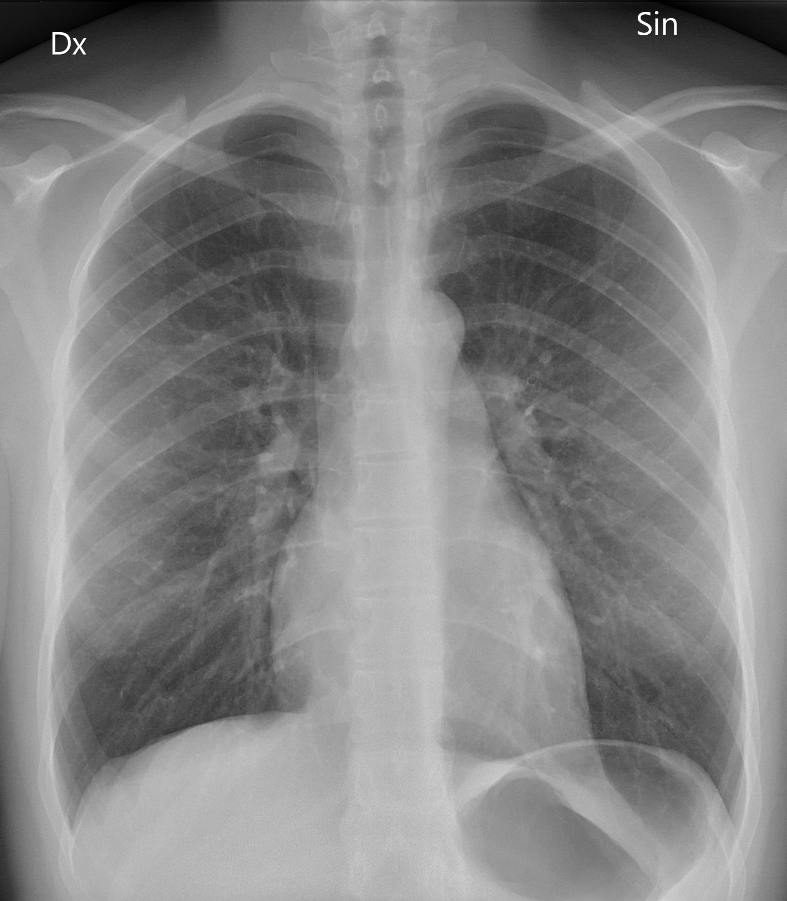
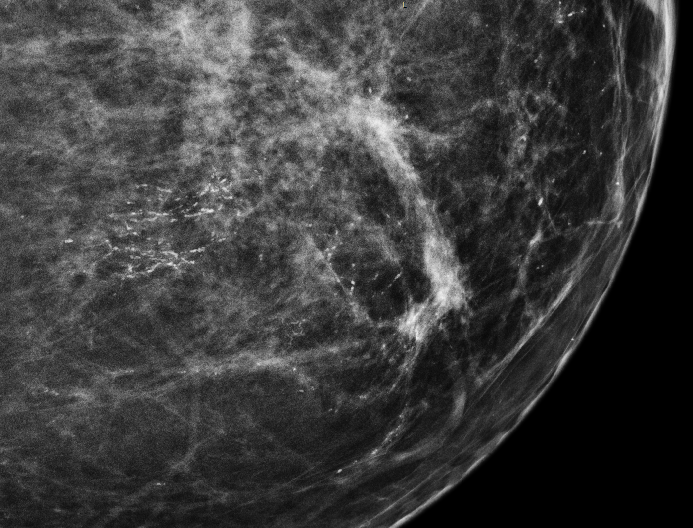
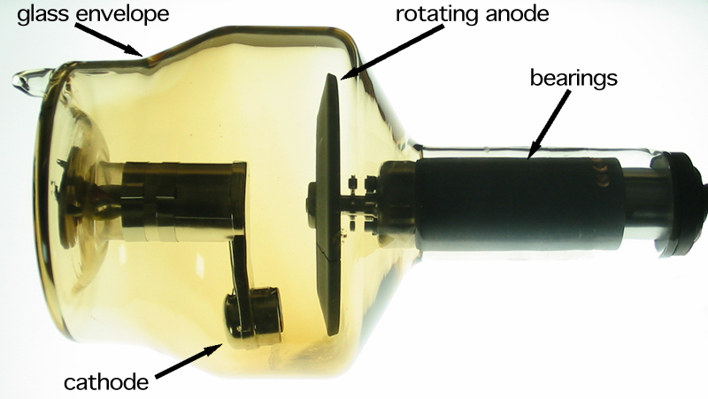

## What makes an X-ray image useful?

A detector measures the X-rays that reach it after they pass through the body.

- **Physical signal:** transmitted X-ray photons.
- **Detector measurement:** a signal at each detector pixel.
- **Contrast mechanism:** different paths transmit different fractions of the incident beam.

::: notes
0–18 min for the opening, applications, and resolution discussion. Ask students to name something a radiograph can show besides bone. Return to the three course terms.
:::

## Chest radiography

:::: {.columns}
::: {.column width="46%"}
{height=113mm}
:::

::: {.column width="51%"}
```{=latex}
\vspace*{8mm}
```
Air-filled lungs generally transmit more X-rays than paths through the heart and nearby soft tissue.

An x-ray can show changes in the lung pattern or help check the position of a tube or line.


:::
::::

```{=latex}
\vskip 0pt plus 1filll
{\footnotesize\color{CourseGray}
\href{https://commons.wikimedia.org/wiki/File:Normal_posteroanterior_\%28PA\%29_chest_radiograph_\%28X-ray\%29.jpg}{Mikael Häggström}\enspace\textperiodcentered\enspace \href{https://creativecommons.org/publicdomain/zero/1.0/}{CC0 1.0}\par}
```

::: notes
This image shows normal anatomy. In the usual grayscale display, higher transmission is darker. Fluid or tissue replacing air can reduce transmission. Point out ribs projected across the lungs. **Look at the image.** Which structures overlap?
:::

## Mammography reveals small differences

:::: {.columns}
::: {.column width="46%"}
{height=95mm}
:::

::: {.column width="51%"}
```{=latex}
\vspace*{8mm}
```
Mammography uses a lower-energy spectrum than general radiography to help distinguish similar breast tissues.

Tiny calcium deposits stand out because they attenuate more strongly than nearby tissue. Small features require good spatial resolution.

:::
::::

```{=latex}
\vskip 0pt plus 1filll
{\footnotesize\color{CourseGray}
\href{https://commons.wikimedia.org/wiki/File:Mammogram_microcalcifications_in_carcinoma_in_situ\%2C_CC\%2C_details.png}{Jmarchn}\enspace\textperiodcentered\enspace \href{https://creativecommons.org/licenses/by-sa/3.0/}{CC BY-SA 3.0}\par}
```

::: notes
Point to the calcifications in the detail image. Compression reduces thickness and motion, and the spectrum is chosen for the breast imaging task. Students are interpreting image formation. Avoid inferring a diagnosis from brightness alone.
:::

## Fluoroscopy shows motion during a procedure

**Fluoroscopy** displays a sequence of X-ray projections during an exam or procedure. Named because historically the detector was a fluorescent screen.

- A clinician can follow a catheter as it moves.
- Iodine contrast can increase attenuation in blood vessels, making their paths easier to see.
- The engineering task is to show changes quickly for guidance.


::: notes
Examples include guiding a catheter or watching contrast pass through the digestive tract. Repeated frames provide temporal information. Mention that frame rate and exposure per frame are design choices.
**Compare:** what information would a single frame leave out?

:::

## How fine a pattern can we see?

The **pixel pitch** $p$ is the center-to-center spacing between pixels. A bright bar and a dark bar make one **line pair**, or one cycle.

| Detector examples | Pixel pitch $p$ | Sampling limit $1/(2p)$ |
|:---|:---|:---|
| Chest radiography | $0.14$–$0.20$ mm | about $2.5$–$3.6$ line pairs/mm |
| Digital mammography | $0.07$–$0.10$ mm | about $5$–$7$ line pairs/mm |

These are sampling limits. Blur reduces the contrast of fine patterns, and noise can hide them.

**Questions:** A pattern has $4$ line pairs/mm at the detector. Which of these detectors sample it finely enough? What could still make the bars hard to see?

::: notes
Allow about 3 minutes. A 4 lp/mm pattern has a 0.25 mm period. At 0.20 mm pitch there are only 1.25 samples per cycle. At 0.10 mm pitch there are 2.5 samples per cycle. The full chest range is below the required sampling rate and the mammography range is above it. These are representative detector pitches, not universal resolution specifications. A finite focal spot, motion, and detector blur reduce contrast; noise can make a low-contrast pattern hard to see even below Nyquist. As a measured example, a 0.10 mm prototype mammography panel had a presampling MTF of 0.28 at 5 cycles/mm, so its sampling limit did not imply full contrast there. Sources: [chest panel example, 0.143 mm](https://pubmed.ncbi.nlm.nih.gov/11756114/), [chest panel example, 0.200 mm](https://pmc.ncbi.nlm.nih.gov/articles/PMC3948899/), [mammography pitches](https://pmc.ncbi.nlm.nih.gov/articles/PMC7533093/), [measured mammography MTF](https://pmc.ncbi.nlm.nih.gov/articles/PMC4280189/).
:::

## X-ray tube

:::: {.columns}
::: {.column width="46%"}
{height=73mm}
:::

::: {.column width="51%"}
```{=latex}
\vspace*{8mm}
```
A heated **cathode** supplies electrons. A voltage accelerates them toward the **anode**, the target. The anode is spun to spread out the heat and prevent it from melting! 

When the electrons interact with the target, some of their energy becomes X-rays. Most becomes heat.

:::
::::

```{=latex}
\vskip 0pt plus 1filll
{\footnotesize\color{CourseGray}
\href{https://commons.wikimedia.org/wiki/File:Rotating_anode_x-ray_tube_\%28labeled\%29.jpg}{Daniel W. Rickey}\enspace\textperiodcentered\enspace \href{https://creativecommons.org/licenses/by-sa/3.0/}{CC BY-SA 3.0}\par}
```

::: notes
18–32 min for tube, spectrum, settings, and the two-exposure example. This is the insert. A rotating target spreads heat across a larger track.
:::

## The tube produces a range of photon energies

**Bremsstrahlung** is the broad spectrum emitted as electrons are deflected and slow in the target.

**Characteristic X-rays** appear at discrete energies set by the target material.

{width=69%}

::: notes
This plot is schematic. The discrete energies illustrate tungsten characteristic emission. The continuum extends up to the energy available from the accelerated electron. The plot shows a filtered beam.
:::

## Tube voltage and current

- **Tube voltage** changes the electron energy and the photon spectrum. An electron accelerated through $80$ kV gains $80$ keV. That is the upper x-ray photon energy at that tube voltage.
- **Tube current** At fixed tube voltage and filtration, more current primarily means more photons. Current multipled by time, mAs, relates to the total number of photons. 

::: notes
It stays the same. Photon output approximately doubles under the stated conditions. At fixed mAs, changing voltage also changes photon output. Ask why kVp and keV describe different quantities.
**Question:** At a fixed voltage, what happens to the upper photon energy if mAs doubles?

:::

## Example: two settings for the same tube

Both exposures use $80$ kVp and the same filtration.

| Exposure | Tube current | Exposure time |
|:---|:---|:---|
| A | $100$ mA | $40$ ms |
| B | $200$ mA | $20$ ms |

1. Calculate the mAs for each. Which produces more X-ray photons?
2. Which has the higher maximum photon energy?
3. If the object is moving, which exposure would give less motion blur?

::: notes
Allow about 3 minutes. Convert milliseconds to seconds. Both give 4 mAs and approximately the same number of emitted photons, assuming stable tube output per mAs. Both have an 80 keV endpoint. B is shorter, so a feature moving at the same speed travels half as far during exposure. Keep the geometry and other settings fixed.
:::

## Photons interaction: pass through, scatter, or absorbed

- **Transmission:** the photon continues along the original path.
- **Photoelectric absorption:** the photon transfers its energy in an interaction that ejects a bound electron.
- **Compton scattering:** the photon transfers some energy to an electron and changes direction.

**Attenuation** is the loss of photons from the primary beam. Some scattered photons still reach the detector.

::: notes
32–43 min for interactions, exponential model, and first calculation. The interaction list emphasizes two important processes at diagnostic energies. Distinguish scatter reaching another detector location from loss from the primary beam.
:::

## Transmission versus depth 

For a single photon energy, the transmission, $T$, is exponential in depth.

$$T=\frac{I}{I_0}=e^{-\mu x}.$$

- $I_0$ and $I$ are the incident and transmitted signals.
- $x$ is the path length in the material, in mm.
- $\mu$ is the linear attenuation coefficient at this energy of the material, in $\mathrm{mm}^{-1}$. Depends on electron density. 

[Here's a web tool for linear attenuation coefficient](https://physics.nist.gov/PhysRefData/FFast/form.html)

```{=latex}
\begin{center}
\textbf{$\mu x$ is dimensionless.}
\end{center}
```

::: notes
Explain that the same fraction is removed for each additional equal thickness. I and I0 are comparable measures of primary beam intensity. For an ideal photon-counting detector they can be interpreted using expected counts with the same exposure.
:::

## What fraction is transmitted?

Suppose $\mu=0.025~\mathrm{mm}^{-1}$.

| Path length | Attenuation exponent $\mu x$ | Transmitted fraction |
|:---|:---|:---|
| $20~\mathrm{mm}$ | $0.50$ | $e^{-0.50}\approx0.61$ |
| $40~\mathrm{mm}$ | $1.00$ | $e^{-1.00}\approx0.37$ |

Why does doubling the thickness square the transmitted fraction?

```{=latex}
{\small The linear attenuation coefficient $\mu$ has units of inverse length. Examples are $\mathrm{mm}^{-1}$ or $\mathrm{cm}^{-1}$. Length and inverse length must have matching units so that $\mu x$ is dimensionless. The product $\mu x$ must stay the same indendent of units. So, $5 \mathrm{mm}^{-1} = 50 \mathrm{cm}^{-1}$. A path length of $1~\mathrm{mm}=0.1~\mathrm{cm}$ gives $\mu x = 5$ with both.\par}
```

::: notes
Each 20 mm layer transmits the same fraction of what enters it in this single-energy model. Coefficient is illustrative.
:::

## A ray can cross more than one material

For two layers, transmission fractions multiply:

$$\frac{I}{I_0}=e^{-\mu_1 x_1}e^{-\mu_2 x_2}.$$

Taking the negative logarithm makes the contributions add:

$$-\ln(I/I_0)=\mu_1 x_1+\mu_2 x_2.$$

**Discuss:** What if the two layers trade places?

::: notes
43–53 min for layers and beam hardening. Layer order leaves primary transmission unchanged at a given energy. Contrast this with where a layer sits in the object. CT will generalize the sum to an integral.
:::

## The spectrum of a beam changes as it passes through tissue

Lower-energy photons are often attenuated more strongly than higher-energy photons.

The transmitted beam then has fewer photons and a higher average photon energy. This is **beam hardening**.

A single value of the attenuation coefficient is a useful starting model. For a broad beam, transmission depends on the spectrum and on how attenuation changes with energy.

::: notes
Recall the tube spectrum. Ask students to sketch what preferential removal of the low-energy end does to its shape. Beam filtration can also harden the incident beam.
:::

## What can one measurement tell us?

Compare two paths at the same photon energy:

- Path A: $20$ mm at $\mu=0.025~\mathrm{mm}^{-1}$.
- Path B: $10$ mm at $\mu=0.050~\mathrm{mm}^{-1}$.

Which path transmits more? What could you infer if you measured only the transmitted fraction?

::: notes
53–57 min. Both give exp(-0.50), about 0.61. A single ray gives total attenuation and cannot identify where along the ray it occurred. Ask students to connect this to overlapping anatomy in the chest radiograph.
:::

## Absorbed dose is energy deposited per mass

To find the **average absorbed dose** in a region of tissue, divide the energy deposited in that region by its mass.

$$D=\frac{E_{\rm deposited}}{m},\qquad
1~\mathrm{Gy}=1~\mathrm{J/kg}.$$

A photon can scatter out of the primary beam and carry away some energy. To calculate dose, we need the energy deposited in the tissue.

Dose estimates use measurements of the X-ray output and a model of the tissue and beam geometry.

::: notes
Use the last 8 minutes for dose and the calculation. A local or regional absorbed dose in gray differs from effective dose in sievert, which is a radiation protection quantity weighted across organs. Avoid comparing the example directly to a whole-body effective dose. [IAEA, Dosimetry in Diagnostic Radiology](https://www-pub.iaea.org/MTCD/Publications/PDF/TRS457_web.pdf).
:::

## Example: estimate the dose to a region of tissue

Suppose $2.0\times10^9$ photons of $50$ keV each enter a region of tissue with a mass of $0.10$ kg. The region absorbs $25\%$ of the **total x-ray energy**.

1. Find the energy deposited in the region, in joules.
2. Find the average absorbed dose in Gy and in mGy.
3. At the same energy and geometry, what happens to the dose if the number of incident photons doubles?

Use $1~\mathrm{keV}=1.602\times10^{-16}~\mathrm{J}$.

::: notes
Teaching example with an assumed deposited energy fraction. Incident energy is 2.0e9 times 50 times 1.602e-16 J, or 1.602e-5 J. The deposited energy is 4.005e-6 J. Dividing by 0.10 kg gives 4.005e-5 Gy, or about 0.040 mGy. If the energy fraction and mass stay fixed, doubling the photon count doubles the dose. The dose is averaged over the specified region and can vary within it.
:::

## Reading and image sources

[IAEA, *Diagnostic Radiology Physics*](https://www-pub.iaea.org/MTCD/Publications/PDF/Pub1564webNew-74666420.pdf), chapters 5 and 6.

- [FDA overview of medical X-ray imaging](https://www.fda.gov/radiation-emitting-products/medical-imaging/medical-x-ray-imaging)
- [FDA mammography](https://www.fda.gov/radiation-emitting-products/medical-x-ray-imaging/mammography) and [fluoroscopy](https://www.fda.gov/radiation-emitting-products/medical-x-ray-imaging/fluoroscopy)
- [NIST X-ray attenuation data](https://www.nist.gov/pml/x-ray-mass-attenuation-coefficients)
- [More NIST X-ray attenuation data](https://physics.nist.gov/PhysRefData/FFast/form.html)
- [Representative detector pitches for chest radiography](https://pmc.ncbi.nlm.nih.gov/articles/PMC3948899/) and [mammography](https://pmc.ncbi.nlm.nih.gov/articles/PMC7533093/)
- [IAEA, Dosimetry in Diagnostic Radiology](https://www-pub.iaea.org/MTCD/Publications/PDF/TRS457_web.pdf)

