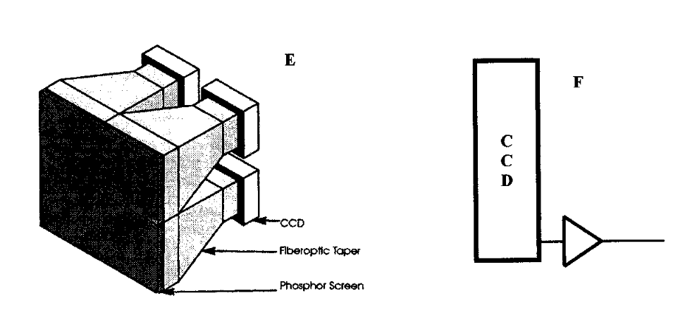
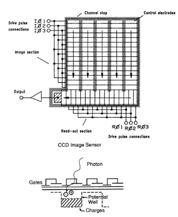
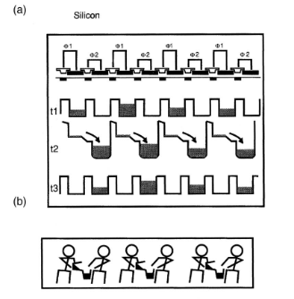
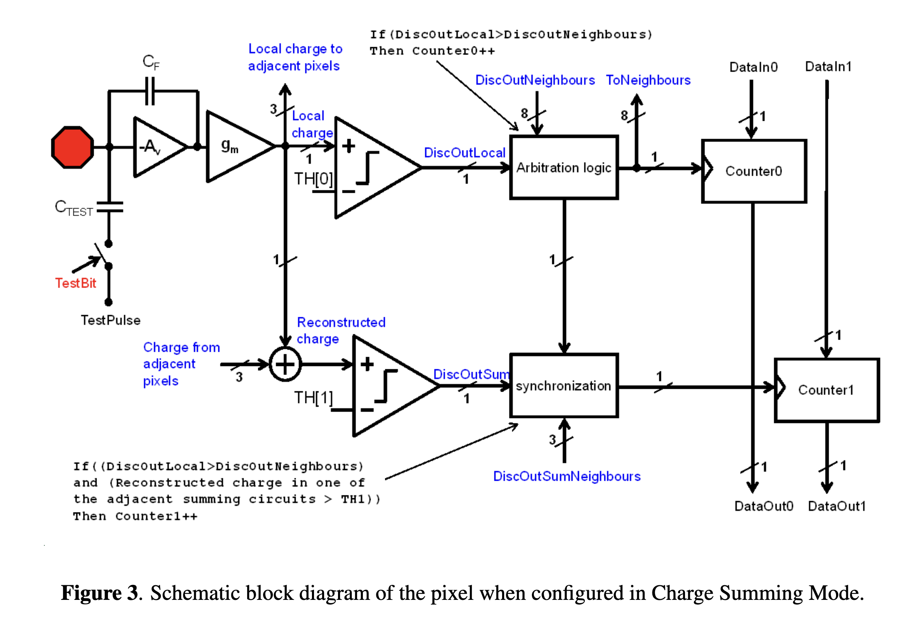
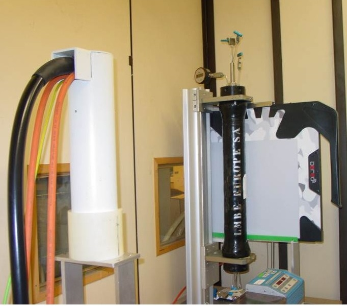

## Two ways to convert X-rays into charge

| Method | Signal path |
|:---|:---|
| **Indirect conversion** | X-rays deposit energy in a scintillator. It emits light that a photodiode converts to charge. |
| **Direct conversion** | X-rays directly produce charge in a photodiode. An electric field moves the charge to the pixel electrodes. |

A **scintillator** is a material that emits light after absorbing energy.

::: notes
Give cesium iodide and amorphous selenium as examples if useful. Ask where spreading could occur in each chain. Both can have blur.
:::

## What does a phosphor do?

A scintillating **phosphor** converts some of the energy deposited by an X-ray into visible light.

- **X-ray stopping.** A thicker layer intercepts more X-rays. Light can also spread farther before reaching the sensor.
- **Light yield.** CsI(Tl), or thallium-doped cesium iodide, produces roughly $54$ visible photons per keV deposited.
- **Light collection.** Only some of that light reaches the sensor and generates charge.

A $50$ keV X-ray that deposits all its energy in CsI(Tl) produces about **2,700 visible photons**.

If each visible photon carries about $2.25$ eV, what fraction of the deposited energy becomes light?

::: notes
8–22 min for the three indirect-conversion slides. 54 × 50 ≈ 2700 photons, before optical and sensor losses. At roughly 550 nm each optical photon carries about 2.25 eV, so this yield corresponds to roughly 12% of deposited energy appearing as visible light. Light yield varies with material, energy, and how it is measured. Separate interaction probability, optical conversion efficiency, collection and sensor quantum efficiency. Columnar CsI helps guide light and limit lateral spread. For a teaching reference see Gruner et al., Fig. 6, which illustrates light spread in a powder screen. [CsI(Tl) material data](https://www.luxiumsolutions.com/sites/default/files/2021-09/Low-Afterglow-Linear-CsITl-Segmented-Arrays.pdf).
:::

## How long does the phosphor keep glowing?

- **Initial decay.** The light output drops rapidly after the interaction. A fast decay component in CsI(Tl) is of order $1~\mu\mathrm{s}$.
- **Persistence, or afterglow.** A weak intensity tail can remain for milliseconds or longer. Trapped energy can be released later as light.

If the first image is bright and the next is dark, what might an x-ray detector built with a persistent phosphor show for the second frame?

::: notes
The second frame can contain residual signal from the first. Contrast the decay of a single pulse with afterglow measured after an exposure. A single exponential with a 1 microsecond time constant cannot describe both. The tail depends on formulation, exposure history, and temperature. Electronic lag can also contribute to detector persistence. [Pulse measurements](https://www.sciencedirect.com/science/article/pii/S0168900222001693) and [afterglow test](https://www.luxiumsolutions.com/sites/default/files/2021-09/Low-Afterglow-Linear-CsITl-Segmented-Arrays.pdf).
:::

## How to transfer light to a CCD?

| Coupling | What it does |
|:---|:---|
| **Lens** | Focuses an image of the phosphor onto the CCD. The lens collects only part of the emitted light. |
| **Fiber-optic plate** | A bundle of fibers guides light from the screen to corresponding positions on the CCD. |
| **Fiber-optic taper** | The bundle has a larger entrance than exit. It maps a larger screen area onto a smaller CCD. |


## CCD light coupling

```{=latex}
{\centering
\includegraphics[height=115mm]{figures/05_ccd_xray.png}\par}

\vskip 0pt plus 1filll

{\centering\footnotesize\color{CourseGray}
\href{https://bigbro.biophys.cornell.edu/publications/169_Gruner_RSI.pdf}{Gruner et al.}\par}
```

::: notes
A charge-coupled device (CCD) stores the photo-generated charge in pixel wells. Clocked gates shift charge toward a readout amplifier. Gruner, Tate and Eikenberry show lens and fiber coupling, single tapers, and a tiled taper array in the electro-optical detector configurations. The local screenshots 05_ccd_xray.png and 05_ccd_xray2.png are instructor references. The CCD-operation screenshots show how charge is shifted. Tapers can lose light, introduce distortion, and create response differences across the tile boundaries. [Gruner et al. review](https://bigbro.biophys.cornell.edu/publications/169_Gruner_RSI.pdf).
:::

## Tiled CCD

A tiled detector uses several taper–CCD modules side by side. The modules cover a larger area, with seams and geometric differences to correct.

{width=92%}

## CCDs 

A charge-coupled device (CCD) stores the photo-generated charge in pixel wells.

:::: {.columns}
::: {.column width="48%"}
{height=98mm}
:::

::: {.column width="48%"}
{height=98mm}
:::
::::

::: notes
A charge-coupled device (CCD) stores the photo-generated charge in pixel wells. Clocked gates shift charge toward a readout amplifier. Gruner, Tate and Eikenberry show lens and fiber coupling, single tapers, and a tiled taper array in the electro-optical detector configurations. The local screenshots 05_ccd_xray.png and 05_ccd_xray2.png are instructor references. The CCD-operation screenshots show how charge is shifted. Tapers can lose light, introduce distortion, and create response differences across the tile boundaries. [Gruner et al. review](https://bigbro.biophys.cornell.edu/publications/169_Gruner_RSI.pdf).
:::


## Integration and counting are readout choices

- **Energy integration:** accumulate the detector signal over an exposure. A larger deposited energy generates more charge and a greater output signal.
- **Photon counting:** resolve individual events and register counts. Some systems also sort events into energy ranges.

Direct and indirect conversion describe how charge is made. Integration and counting describe what the readout reports.

::: notes
Use two photons with different energies. If both are fully detected in a simple example, the counter registers two events and the integrator weights them by deposited energy. Real counting systems have thresholds and can miss overlapping events.
:::

## How many X-rays interact in a thin silicon wafer?

Take a $300~\mu\mathrm{m}$ active Si layer, with X-rays entering perpendicular to the wafer. The fraction that interacts is $1-e^{-\mu t}$.

| Photon energy | Si attenuation length $1/\mu$ | Interacts in $300~\mu\mathrm{m}$ |
|:---|:---|:---|
| $20$ keV | $0.96$ mm | $27\%$ |
| $30$ keV | $3.0$ mm | $9.5\%$ |
| $60$ keV | $13.4$ mm | $2.2\%$ |

**Discuss:** If most photons pass through, would smaller pixels fix the problem?

::: notes
22–39 min for direct conversion and Medipix. Use the commercial camera slide as a quick example or reference. Use NIST total mass attenuation coefficients 4.464, 1.436, and 0.3207 cm²/g with Si density 2.329 g/cm³. 300 µm is 0.030 cm. These numbers include scattering and are interaction probabilities. Useful recorded-event efficiency can be lower, depending on deposited energy, active thickness, and threshold. To intercept more of the beam one can increase the path length through active Si or use a more strongly attenuating material. The local 05_semiconductor_attenlen.png screenshot from Gruner et al. is useful for comparing materials. [NIST silicon data](https://physics.nist.gov/PhysRefData/XrayMassCoef/ElemTab/z14.html).
:::

## Amorphous selenium wide-area panel

**Amorphous selenium (a-Se)** can be deposited as a continuous layer over a large pixel array.

1. An X-ray interaction creates electrons and holes in the selenium.
2. A voltage across the layer drives the charges toward the electrodes.
3. Each pixel stores charge. Thin-film transistors switch the pixels for readout.

A direct mammography panel can cover about $24\times29$ cm with $70~\mu\mathrm{m}$ pixel pitch. Thin film transistor electronics allows for these large panels. 

::: notes
Connect to integration: this architecture collects charge from many X-rays per pixel during one exposure. A continuous photoconductor can span a much larger area than a single readout chip. Eliminating light spread helps preserve detail. Thickness, high electric field, charge trapping and dark current still matter. [Mammography panel study](https://pmc.ncbi.nlm.nih.gov/articles/PMC3276250/).
:::

## Medipix3 counts individual X-rays

**Medipix3** is a CMOS readout chip bonded pixel by pixel to a separate semiconductor sensor. Direct detection with digital pulse counting. 

{height=100mm}

```{=latex}
{\centering\footnotesize\color{CourseGray}
\href{https://iopscience.iop.org/article/10.1088/1748-0221/8/02/C02016/pdf}{Ballabriga 2013}\par}
```


## Medipix3 counts individual X-rays

**Medipix3** is a CMOS readout chip bonded pixel by pixel to a separate semiconductor sensor.

$$\text{X-ray}\ \longrightarrow\ \text{charge in sensor}\ \longrightarrow\
\text{pulse in readout pixel}$$

If the pulse crosses a threshold, the pixel adds one to a counter. An energy threshold rejects small pulses. Two thresholds can also define an energy range.

A fine-pitch chip has $256\times256$ pixels on a $55~\mu\mathrm{m}$ pitch, about $14$ mm across.

::: notes
The sensor layer absorbs the X-ray. Each tiny bump bond carries charge to the corresponding input on the readout chip. Silicon is one sensor choice. More strongly attenuating semiconductors such as CdTe can be useful for higher-energy X-rays. In a simple cumulative-threshold configuration, subtracting the counts above the higher threshold from those above the lower threshold gives a count for the intervening energy range. [CERN Medipix3](https://medipix.web.cern.ch/medipix3).
:::

## How much charge does one X-ray produce?

An X-ray deposits energy in the sensor and creates **electron–hole pairs**. The mean energy per pair, $W$, is about $3.6$ eV in silicon and $4.4$ eV in CdTe.

$$\bar N_{\rm pairs}=\frac{E_{\rm deposited}}{W},
\qquad |Q|=e\,\bar N_{\rm pairs}\quad\text{with full charge collection}.$$

**Example:** If a $50$ keV X-ray deposits all its energy in silicon, it creates about $14{,}000$ pairs. The collected signal is about $2.2$ fC.

A larger energy deposit gives a larger charge pulse. This is how a threshold on charge can correspond to a threshold on energy.

::: notes
50,000 eV / (3.6 eV/pair) is about 13,900 pairs. Multiply by 1.602e-19 C to get 2.23e-15 C. Each collected pair contributes one elementary charge to the full signal, even though both carriers can contribute as they drift. The pair-creation energy exceeds the band gap because some deposited energy goes into processes such as lattice vibrations. An X-ray that scatters and escapes can deposit less than its incident energy. [Measured detector comparison and pair-creation energies](https://journals.iucr.org/s/issues/2010/04/00/gf5024/index.html).
:::

## Charge sharing across pixels

Suppose a $50$ keV X-ray deposits all its energy in silicon. The charge cloud spreads across two pixels, which collect charge equivalent to $30$ and $20$ keV.

At a threshold equivalent to $35$ keV, two independent pixels would register zero counts! 

Medipix3 can combine signals from nearby pixels and assign one count. This helps recover the event and estimate its energy.

::: notes
The 35 keV threshold corresponds to about 9700 elementary charges in Si. The two pixels collect about 8300 and 5600, so neither crosses the threshold. If the threshold were below 20 keV it could be counted twice. Summing and allocating the charge mitigates this problem. At high rates separate events can arrive close enough in time to overlap, an effect called pileup. Charge summing and thresholding are readout choices. The absorbing layer still sets the basic stopping probability. [CERN Medipix3 technical brief](https://medipix.web.cern.ch/sites/default/files/2020-06/Documents%20Collaborations/tech-brief-medipix3.pdf).
:::

## Quantum efficiency (QE)

In a simple counting detector, the **quantum efficiency** $\eta$ is the fraction of incident photons registered, on average.

$$\bar N=\eta\,\bar N_{\rm incident}.$$

If $400$ photons reach a pixel on average and $\eta=0.50$, then the mean detected count is $200$.

::: notes
Use a single photon energy and independent detection with fixed probability. This simple efficiency is not detective quantum efficiency, which compares input and output SNR. The incident count here is at the detector after attenuation.
:::

## Photon counts and SNR

For independent arrivals and detection in this model,

$$\sigma_N=\sqrt{\bar N},\qquad
\frac{\sigma_N}{\bar N}=\frac{1}{\sqrt{\bar N}}.$$

| Mean detected count | Standard deviation | SNR |
|:---|:---|:---|
| $100$ | $10$ counts | 10 = 20 dB |
| $400$ | $20$ counts | 20 = 26 dB |

Which exposure has the larger fluctuation relative to its mean?

::: notes
The standard deviation rises while the fractional fluctuation falls. Readout noise can also matter in real detectors. These equations are for the ideal photon-counting model.
:::

## Contrast, blur, and noise change different features

{width=92%}

::: notes
Images are simulated with the same grayscale and the same attenuation pattern. Left is expected transmission. Middle adds Gaussian blur as a detector approximation. Right shows ideal Poisson counts normalized by incident count. Point out that noise does not change the expected signal in this model.
:::

## Change the feature thickness

{width=92%}

What did we disucss last time that explains the attenuation. Here the sample thickness varies. 

::: notes
Static activity panel. Both use the same background thickness and incident exposure. The insert replaces part of the background along affected rays. Increased insert thickness increases attenuation because the insert coefficient exceeds the background coefficient.
:::

## Impact of SNR on visibility

{width=92%}

The contrast and object are the same. Just more photons on the right. 

::: notes
Static activity panel. Same object as the thinner-insert case. The incident count changes from 80 to 320 per pixel. The fourfold increase halves the fractional standard deviation under the ideal counting assumptions. Display uses the same normalized transmission scale, not raw counts.
:::

## What detects a dental X-ray today?

| Intraoral receptor | How it makes the image |
|:---|:---|
| **Scintillator + CMOS** | A layer such as CsI(Tl) makes light. The CMOS array reads it immediately. One commercial sensor uses $20~\mu\mathrm{m}$ pixels. |
| **Storage phosphor plate** | A thin plate stores the image. A separate laser scanner reads it after exposure. |
| **Direct-conversion sensor** | A semiconductor converts X-rays into charge. Newer commercial examples use a separate absorbing layer, such as a lead-halide photoconductor, on a silicon readout. |

::: notes
51–62 min for dental receptors, dose and exposure timing. The 20 µm example is the OpenSensorX. The direct-conversion example is the EzSensor XHD, whose FDA summary identifies CsPbBr3 and single-crystal silicon. Direct conversion is available commercially but is not the only modern approach. The source is outside the mouth for a bitewing. The sensor is inside. [Intraoral receptor survey](https://pmc.ncbi.nlm.nih.gov/articles/PMC11966016/), [OpenSensorX](https://www.accessdata.fda.gov/cdrh_docs/pdf22/K220556.pdf), [EzSensor XHD](https://www.accessdata.fda.gov/cdrh_docs/pdf23/K232255.pdf).
:::

## Commercial intraoral sensors

| Model | Conversion | Pixel pitch | Active area |
|:---|:---|:---|:---|
| DEXIS Titanium | CsI scintillator + CMOS | $19.5~\mu\mathrm{m}$ | $33\times26$ mm |
| DentiMax OpenSensorX (size 1) | CsI(Tl) scintillator + CMOS | $20~\mu\mathrm{m}$ | $30\times20$ mm |
| EzSensor XHD (size 1.5) | Direct $\mathrm{CsPbBr_3}$ on Si | $14.8~\mu\mathrm{m}$ | about $33\times24$ mm |

**Discuss:** If two sensors have the same pixel pitch, what else would you measure to compare how well they show a small feature?

::: notes
The active area is the part that records the image. The Titanium example is variant 1 with clipped corners. These are commercial examples of different designs. They are not ranked by sales or image quality. Students can suggest MTF, noise or DQE at relevant frequencies, measured under comparable conditions. [DEXIS Titanium, FDA K172918](https://www.accessdata.fda.gov/cdrh_docs/pdf17/K172918.pdf), [DentiMax OpenSensorX, FDA K220556](https://www.accessdata.fda.gov/cdrh_docs/pdf22/K220556.pdf), [EzSensor XHD, FDA K232255](https://www.accessdata.fda.gov/cdrh_docs/pdf23/K232255.pdf).
:::

## Detector efficiency reduces exposure

Suppose we need the same mean detected count to see a feature. Compare two ideal counting detectors with efficiencies of $40\%$ and $60\%$.

$$\bar N_{\rm incident}=\frac{\bar N_{\rm detected}}{\eta}$$

What fraction of the original incident photons does the more efficient detector need?

With the same beam quality and geometry, reducing tube output can reduce patient dose. Keeping the beam limited to the area of interest also helps.

::: notes
For the same mean count, the ratio is 0.40/0.60 = 2/3, or one third fewer incident photons at the detector. In this ideal Poisson example that preserves count SNR. A clinical detector comparison must also consider blur and noise for the task. DQE is a frequency-dependent measure of how well a detector preserves squared SNR. The toy ratio is not a clinical dose claim. [ADA dental radiography safety](https://www.ada.org/resources/ada-library/oral-health-topics/x-rays-radiographs).
:::

## What switches a dental X-ray beam on and off?

Many intraoral units use a **stationary tungsten target**. Short exposures and cooling time between exposures limit heating.

The filament supplies electrons. A high-frequency generator applies the tube voltage for a timed interval. X-rays are produced while accelerated electrons strike the target.

The Planmeca ProX offers $60$–$70$ kV, $2$–$8$ mA, and exposure settings from $0.01$ to $2$ s.

::: notes
Rotation distributes heat over a larger target track. Beam timing is electrical. The filament can be heated before the exposure, so the timing need not wait for it to heat and cool each time. A generator applies and removes the high voltage around the selected interval. The actual voltage has finite rise and fall times. 0.01 s is the shortest selectable exposure setting in the Planmeca example. The 66 kHz specification describes generator switching, not a stream of 66,000 separate clinical exposures per second. FDA documentation lists stationary tubes in representative high-frequency intraoral units. [Planmeca specifications](https://www.planmeca.com/dental-imaging/intraoral-imaging/intraoral-x-ray-unit/technical-specifications/), [FDA stationary-tube examples](https://www.accessdata.fda.gov/cdrh_docs/pdf13/K132041.pdf).
:::

## Specifications and impact

A small feature has weak contrast and appears noisy.

- What would more detected photons change?
- What would a narrower PSF change?

What happens when two structures overlap along the same ray?

::: notes
62–65 min debrief. More photons improve relative photon statistics. A narrower PSF preserves sharper edges and can improve small-feature contrast. Display magnification cannot recover unmeasured detail. Greater incident fluence can increase radiation exposure when other factors are held fixed.
:::

## Reading and image sources

[IAEA, *Diagnostic Radiology Physics*](https://www-pub.iaea.org/MTCD/Publications/PDF/Pub1564webNew-74666420.pdf), chapters 4 and 7.

- [Gruner, Tate and Eikenberry, CCD area X-ray detectors](https://bigbro.biophys.cornell.edu/publications/169_Gruner_RSI.pdf)
- [NIST silicon attenuation coefficients](https://physics.nist.gov/PhysRefData/XrayMassCoef/ElemTab/z14.html)
- [CERN Medipix3](https://medipix.web.cern.ch/medipix3)
- [ADA dental radiography and radiation safety](https://www.ada.org/resources/ada-library/oral-health-topics/x-rays-radiographs)

The transmission examples are simulations of a uniform background with a small insert.


<!--
## A flat-panel detector records a projection

:::: {.columns}
::: {.column width="46%"}
{height=86mm}
:::

::: {.column width="51%"}
The panel contains an array of sensing elements. Each element collects a signal over a small area and reports a value.

**Pixel pitch** is the center-to-center spacing between elements.

:::
::::

```{=latex}
\vskip 0pt plus 1filll
{\footnotesize\color{CourseGray}
\href{https://commons.wikimedia.org/wiki/File:DeReO_Flat_panel_detector.jpg}{RadXman}\enspace\textperiodcentered\enspace \href{https://creativecommons.org/licenses/by-sa/3.0/}{CC BY-SA 3.0}\par}
```

::: notes
5–8 min for hardware and the two conversion paths. The photo shows a laboratory test setup with the detector behind the cylindrical object. The same source–object–detector geometry applies to medical projection radiography.
:::
-->

## A commercial camera tiles Medipix3 chips (aside)

The **ADVACAM WidePIX CHROMATIC 25** uses a $5\times5$ array of Medipix3 chips. It is a photon-counting camera for applications such as industrial X-ray imaging.

| Specification | Published value |
|:---|:---|
| Image matrix | $1280\times1280$ pixels |
| Nominal interior pixel pitch | $55~\mu\mathrm{m}$ |
| Sensor options | $300$ or $500~\mu\mathrm{m}$ Si, or $1000~\mu\mathrm{m}$ CdTe |
| Counter depth | $12$ or $24$ bits, depending on mode |

::: notes
Use as a brief example or leave for review. Five tiles times 256 pixels gives 1280 pixels per side. The manufacturer notes wider pixels near chip edges and small gaps between tiles. A longer path increases interaction probability for a given material and energy. Sensor material and thickness affect stopping, while the Medipix chip counts and reads out the events. [Manufacturer datasheet](https://advacam.com/content/uploads/2026/03/WidePIX-CHROMATIC-25-Datasheet-2026-03-02.pdf).
:::