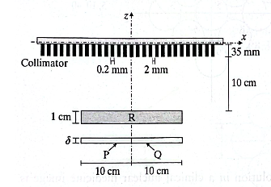

## Where did this photon come from?

A gamma camera detects a photon at one point in its crystal. Many paths through the patient could lead to that point.

We must develop a detector system that localizes the radioactive decay.

- In x, y, across the detector face and 
- In z, the distance from the decay to the detector (i.e., depth into body). 

::: notes
0–8 min. A pixel position alone does not give direction. Compare the mechanical collimator to the geometrical restriction in a pinhole camera.
:::

## Scintillation camera

An example Anger scintillation camera. 

```{=latex}
{\centering
\includegraphics[height=108mm,width=0.94\linewidth,keepaspectratio]{figures/08_anger_camera.png}\par}
\vskip 0pt plus 1filll
{\footnotesize\color{CourseGray}
Prince and Links, \textit{Medical Imaging Signals and Systems}, Fig. 8.1.\par}
```

::: notes
Follow the signal from the patient through the collimator and crystal, then through the light sensors and position logic. Here X and Y encode estimated position. Z is the summed pulse-height signal used for energy selection. Anger is the inventors name. 
:::

## A collimator selects photon directions

A **parallel-hole collimator** is a plate with many long holes separated by absorbing walls called **septa**.

- A photon traveling nearly along a hole can reach the crystal.
- A photon traveling at a larger angle is likely to hit a wall and be absorbed.
- Each accepted hit gives an estimate of transverse source position.

```{=latex}
{\centering
\includegraphics[width=0.60\linewidth,keepaspectratio]{figures/08_collimators.png}\par}
\vskip 0pt plus 1filll
{\footnotesize\color{CourseGray}
Prince and Links, \textit{Medical Imaging Signals and Systems}, Fig. 8.2.\par}
```

::: notes
The holes accept a range of angles, so a point source produces a spot.
8–18 min. Sketch a hole and two rays on the board. A planar image combines sources along depth. Explain penetration through septa at higher photon energies.
Compare parallel-hole, converging, diverging, and pinhole geometries. Ask which rays can pass through each. Parallel-hole geometry is used in the following resolution example.
:::

## Which photons make it to the crystal?

{height=103mm}

The accepted rays reach nearby detector positions. Those positions form the camera’s point spread response.

## Collimator resolution

```{=latex}
{\centering
\includegraphics[height=80mm,width=0.75\linewidth,keepaspectratio]{figures/08_collimator_resolution.png}\par}
\vskip 0pt plus 1filll
{\footnotesize\color{CourseGray}
Prince and Links, \textit{Medical Imaging Signals and Systems}, Fig. 8.10.\par}
```

For hole width $d$, effective length $L$, and distance $z$ from the collimator, a simple geometric estimate is
$$R_{\rm coll}(z)\approx d\left(1+\frac{z}{L}\right).$$


::: notes
In this figure l is hole length, b spans the scintillator thickness in the textbook diagram, d is hole width, and |z| is source distance from the entrance face. Map these distances to any formula before substituting values. The next slide uses the simple approximation with a negligible distance from the collimator exit to the assumed detection plane.
:::

## Distance broadens the point response

For hole width $d$, effective length $L$, and distance $z$ from the collimator, a simple geometric estimate is
$$R_{\rm coll}(z)\approx d\left(1+\frac{z}{L}\right).$$

**Example problem:** Use $d=2$ mm and $L=25$ mm. Estimate the collimator blur at $z=25$ mm and at $z=75$ mm.

::: notes
18–29 min. 4 mm versus 8 mm. Define R as an approximate geometric resolution width. The relation assumes parallel holes and ignores penetration and detector blur. A common approximate system resolution is sqrt(R_coll²+R_int²).
:::

## Finer collimation reduces counts

Smaller holes or a longer path through each hole reduce the angular range accepted. The image can preserve finer detail, and fewer photons reach the detector.

Consider a small bright feature and a broad faint feature. Which benefits most from finer collimation? Which might benefit from more counts?

::: notes
29–36 min. Compare otherwise similar collimators. A broad faint feature may be count limited. Small feature visibility also depends on its contrast and photon statistics.
:::

## Collimator efficiency 

Longer collimator holes pass fewer photons. The efficiency of a collimator (fraction of photons that pass through) can be estimated as

$$ \epsilon = \left( \frac{0.25 d^2}{l(d+h)} \right)^2 $$


## Photomultiplier tube

Light releases electrons at the photocathode. At each dynode the number of electrons is increased by x3, or x4. 

```{=latex}
{\centering
\includegraphics[height=115mm,width=0.94\linewidth,keepaspectratio]{figures/08_PMT.png}\par}
\vskip 0pt plus 1filll
{\footnotesize\color{CourseGray}
Prince and Links, \textit{Medical Imaging Signals and Systems}, Fig. 8.3.\par}
```

::: notes
Light releases electrons at the photocathode. Successive dynodes multiply the electrons, and the anode collects the resulting charge pulse. The relative pulse heights across several PMTs support the position estimate. The total supports the energy estimate.
:::

## How the Anger camera estimates position

The classical **Anger camera** uses a large NaI(Tl) scintillation crystal and an array of PMTs.

If sensor $i$ gives signal $a_i$ at position $(x_i,y_i)$, a simple position estimate is

$$\hat x=\frac{\sum_i x_i a_i}{\sum_i a_i},\qquad
\hat y=\frac{\sum_i y_i a_i}{\sum_i a_i}.$$

The total signal $\sum_i a_i$ estimates deposited energy. 

::: notes
36–46 min with the calculation. NaI(Tl) means thallium-activated sodium iodide. The centroid is a teaching approximation. Real cameras use calibration and corrections. Direct-conversion pixelated cameras are another design.
:::

## Example position from two signals

Two light sensors lie at $x=-15$ mm and $x=+15$ mm. One event gives pulse signals of $18$ and $42$ units.

1. Find the weighted position estimate.
2. Which direction would it move if more light reached the left sensor?
3. What happens to the energy estimate if both signals double?

::: notes
Weighted estimate is (+360)/60 = +6 mm. It moves left if the left signal increases. The sum doubles under a linear calibration.
:::

## An energy window rejects Compton scattered photons

A photon that Compton scatters in tissue changes direction and loses energy. It can reach a detector position that suggests the wrong origin.

For a $140$ keV photopeak, a window of $\pm10\%$ accepts measured energies from $126$ to $154$ keV.

::: notes
46–55 min. Reject 114, accept 132. Small-angle scatter may stay inside the window. Narrower windows can discard true events because measured energies fluctuate.
:::

## Pulse-height spectrum

The greatest pulse height is from the direct photons (photopeak). There is a maximum energy transferred and then released for Compton scattering, hence the Compton edge. The Compton energy plateau is continuous in energy. 

```{=latex}
{\centering
\includegraphics[height=99mm,width=0.94\linewidth,keepaspectratio]{figures/08_compton_pulse_height.png}\par}
\vskip 0pt plus 1filll
{\footnotesize\color{CourseGray}
Prince and Links, \textit{Medical Imaging Signals and Systems}, Fig. 8.5.\par}
```

::: notes
The horizontal axis is pulse height in arbitrary units, proportional to deposited energy. It is not energy in keV. The vertical axis is logarithmic. Compare the photopeak and the lower pulse heights from partial deposits. Point to the acceptance window. Some scattered photons can remain inside the window.
:::

## What determines the brightness of a planar image?

The displayed image contains accepted counts. 

- More tracer increases brightness. 

How do these mechanisms impact brightness? 

- Tissue attenuation
- tracer depth
- scatter 
- blur 
- acquisition time

::: notes
55–62 min. The deeper deposit may lose more primary photons through attenuation and broaden through collimator geometry. State that the example holds activity, detector settings and tissue composition fixed.
:::

## Imaging geometry

```{=latex}
{\centering
\vskip 30pt 
\includegraphics[height=103mm,width=0.94\linewidth,keepaspectratio]{figures/08_imaging_geometry.png}\par}
\vskip 0pt plus 1filll
{\footnotesize\color{CourseGray}
Prince and Links, \textit{Medical Imaging Signals and Systems}, Fig. 8.9.\par}
```

::: notes
The camera-centric axes put x and y in the detector plane and z perpendicular to it. Follow the different photon paths and ask which could contribute to a useful position estimate. Photon loss and scatter affect how the activity distribution maps into measured counts.
:::

## Received signal at the detector

Using the camera coordinates in Figure 8.9, the detector lies at $z=0$ and the source is at $z<0$. Prince and Links write

$$
\begin{aligned}
\phi(x_d,y_d)
&=A_h\int_{-\infty}^{0}
\frac{f(x_d,y_d,z)}{4\pi z^2}\\
&\qquad{}\times
\exp\!\left[-\int_z^0\mu(x_d,y_d,z';E)\,dz'\right]\,dz.
\end{aligned}
$$

$f$ describes the source distribution. $\mu$ describes attenuation at the emitted photon energy $E$. $A_h$ is the area of the collimator hole.

```{=latex}
\vskip 0pt plus 1filll
{\footnotesize\color{CourseGray}Prince and Links, \textit{Medical Imaging Signals and Systems}, Eq. 8.7.\par}
```

::: notes
Equation supplied by the instructor. Verify the textbook's definitions of f and A_b when assigning absolute units. If f is volumetric photon emission rate and A_b is accepted source cross-sectional area, phi is fluence rate, photons/s/cm². In a 2D analogue, the projection is instead per unit detector length as requested in Problem 8.15. Keep the geometric factor consistent with that normalization. Source activity must also include photon yield if f is given as decays per volume per time.
:::

## Geometric spreading and attenuation

The depth integral adds contributions from each source depth.

- $1/(4\pi z^2)$ describes geometric spreading from isotropic emission. A fixed receiving area subtends a smaller solid angle farther from the source.
- $\exp[-\int_z^0\mu\,dz']$ is the fraction of primary photons surviving the attenuation of the material along that path.

For uniform tissue filling a thickness $|z|$,

$$\frac{1}{4\pi z^2}\,
\exp\!\left[-\int_z^0\mu\,dz'\right]
=\frac{e^{-\mu|z|}}{4\pi z^2}.$$

::: notes
z is negative in this camera convention, while depth is |z|. For a fixed small source and receiving area, doubling distance gives a factor of one quarter geometrically. Attenuation depends on the tissue path. An air gap contributes distance with little additional attenuation. In an extended uniform source and parallel-hole system, the source area accepted by a detector bin can grow with depth, partly compensating geometric spreading. Avoid imposing a universal inverse-square law on the whole planar image.
:::

## A projection combines source strength and transport

For a thin emitting layer at depth $z_0<0$ and thickness $\Delta z$, the depth integral becomes approximately

$$
\phi(x_d,y_d)\approx
\frac{A_h f(x_d,y_d,z_0)\Delta z}{4\pi z_0^2}
\,e^{-\int_{z_0}^0\mu\,dz'}.
$$

A planar image therefore depends on source strength, depth, and attenuation. Its brightness alone leaves several possible explanations.

How could two equally active deposits produce different signals at the camera?

::: notes
This is a thin-layer approximation with fixed area factor. The layer is thin enough that source strength and transport weights vary little across it. Problem 8.15 combines radioactive decay with attenuation through R and a specified collimator. Use consistent units before evaluating attenuation: 0.1/mm times 10 mm gives an exponent of one.
:::


## From a planar image to several views

A planar camera gives a projection of tracer activity weighted by detection and photon transport. Rotating the camera acquires projections from other directions.

**Exit question.** What additional information could those views give about two overlapping deposits?

[IAEA, *Nuclear Medicine Physics*](https://www-pub.iaea.org/MTCD/Publications/PDF/Pub1617web-1294055.pdf)

::: notes
62–65 min. Preview SPECT. Suggested reading: Prince and Links, chapter 8.
:::


## Example problem 8.15: Module \#3 HW

A planar scintigraphy imaging system (assume a 2D system) uses the collimator shown in Figure P8.5.

:::: {.columns}
::: {.column width="39%"}
{height=88mm}
:::
::: {.column width="58%"}
Three compartments P, Q, and R mimic different tissues:

$$\mu_P=0,\quad \mu_Q=0,\quad\mu_R=0.1~\mathrm{mm}^{-1}.$$

Assume $\delta\approx0$ mm. Initially, $N_0$ atoms of radionuclide A (half-life 3 h) are uniform in P, and $\frac12N_0$ atoms of radionuclide B (half-life 6 h) are uniform in Q.
:::
::::


```{=latex}
\vskip 0pt plus 1filll
{\footnotesize\color{CourseGray}Prince and Links, \textit{Medical Imaging Signals and Systems}, Problem 8.15.\par}
```

::: notes
Hole width is 2 mm, septal thickness is 0.2 mm, and collimator length is 35 mm. R is 1 cm thick; P and Q are 10 cm wide each. The vertical 10 cm label is between the collimator entrance and the top of R. Use the diagram when calculating the total source distance. This exercise can extend beyond the timed class.
:::

## Example problem 8.15: Module \#3 HW

(a) Compute the projection $\phi(x)$, in photons $\mathrm{s}^{-1}\mathrm{cm}^{-1}$, at $t=0$ and $t=t_{1/2}^A$.
(b) Determine the time $t_{\max}$ when $|\phi(5)-\phi(-5)|$ is maximum (where +5, -5 are in cm).
(c) What is the collimator efficiency and resolution?
(d) What is the absolute signal difference at $t=3$ h, incorporating collimator efficiency?
(e) What is the width of compartment P in the final image? Assume system resolution is dominated by collimator resolution.


```{=latex}
\vskip 0pt plus 1filll
{\footnotesize\color{CourseGray}Prince and Links, \textit{Medical Imaging Signals and Systems}, Problem 8.15.\par}
```

::: notes
Positions +5 and -5 are in cm. 
:::
